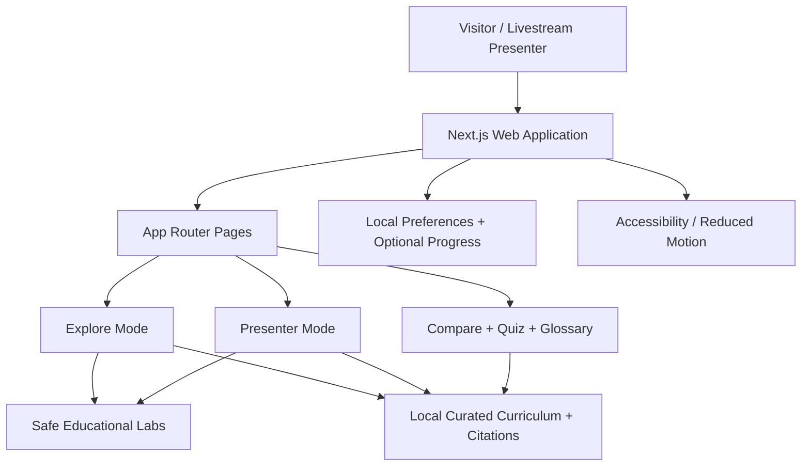

# MARKETWISE — Interactive Market Literacy Studio

**Version:** 1.1 (Claude Code handoff) | **Date:** 2026-10-30 | **Audience:** Ghana-based livestream audience and global general learners | **Status:** Implementation specification

> **Mission:** Help viewers distinguish forex, stocks, commodities, crypto and sports betting through clear mechanisms, economic purpose, real risks and interactive visual explanations. This is education, **not** investment advice, trading signals or gambling assistance.

## 1. Executive brief

Build one polished, responsive, accessible web application with two complementary modes:

1. **Explore Mode**: public-facing, self-paced lessons, visual labs, quizzes, glossary, side-by-side comparisons and references.
2. **Presenter Mode**: keyboard-controlled 16:9 slide deck built into the same site, with speaker notes, audience prompts, chapter navigation, fullscreen, timer, and a one-click link from a slide to the corresponding interactive lab.

The app must be compelling in a live YouTube/TikTok/Facebook stream and sustainable for later publication as an educational product. **It must not execute trades, connect brokerage or gambling accounts, place bets, collect deposits, provide picks or trading signals, or simulate wagering.** All visual market data is clearly synthetic at MVP launch.

### North-star question

**“Is forex just sports betting in a suit?”** Answer: **No, they are not the same activity or market mechanism. But both can involve uncertainty, risk, speculation, and behavioral mistakes. A legitimate market structure is not a guarantee that speculative participation is sensible or profitable.**

### Non-goals

Live brokerage/trading integration, crypto wallets or transaction signing, sportsbook connections, gambling account links, financial advice, automated trading, real-money transactions, personalized portfolio allocation, gambling odds comparison, prediction or picks.

## 2. Audience, outcomes and editorial principles

**Audience:** non-specialists, first-time learners, students, young adults, curious livestream viewers. No assumed financial background. Ghana-relevant examples may mention GHS currency conversion, local businesses importing goods, gold and cocoa, without claiming live Ghanaian exchange rates or legal permissions.

By the end, a viewer should be able to:

- Describe the economic purpose and common actors in each system.
- Distinguish buying an asset, buying an ownership stake, entering a derivative contract and making a wager.
- Explain what moves currency rates, commodity prices, equity prices and crypto prices at a high level.
- Understand that risk, uncertainty and expected outcomes are not equivalent across systems.
- Spot misleading claims: “guaranteed returns,” “no risk,” “everyone profits,” “house cannot win,” “leverage creates free money.”
- Explain why fees, spreads, leverage, volatility, liquidity and custody matter.
- Recognize that speculation can become gambling-like in behavior even when the underlying asset market has a broader economic purpose.

**Editorial standard:** neutral, accurate, no glamorization; separate fact from example, and example from simulation. Never state that any market is inherently a safe way to earn income. Every numerical illustration displays `Illustrative only — not live data`. Definitions reviewed against reference sources before launch.

## 3. User journeys

**Visitor path:** Landing → five-system explainer → side-by-side compare → choose a lesson → interact with safe conceptual lab → quick comprehension check → review key misconceptions → glossary/source links.

**Livestream path:** Presenter opens `/present` → fullscreen → introduction hook → five modules → interactive break at specific slides → audience polls (local/no collection) → myth-busting → recap → QR code to `/explore` (optionally generated from configured production URL).

**Post-stream path:** Learner visits `/explore`, bookmarks modules, completes an anonymous locally saved progress tracker, shares a specific lesson URL, reads citations and date-updated notes.

## 4. Site map and routes

| Route                     | Purpose                         | Key UX                                                                                                                                             |
| ------------------------- | ------------------------------- | -------------------------------------------------------------------------------------------------------------------------------------------------- |
| `/`                       | Animated editorial landing page | bold hero, system constellation, launch deck / explore buttons                                                                                     |
| `/explore`                | Five knowledge paths            | progressive, animated module cards                                                                                                                 |
| `/explore/forex`          | Foreign exchange                | currency pair explainer, rate drivers, leverage risk                                                                                               |
| `/explore/stocks`         | Equities                        | ownership map, price vs business, dividend illustration                                                                                            |
| `/explore/commodities`    | Physical goods and futures      | supply-chain story, spot vs futures diagram, hedging                                                                                               |
| `/explore/crypto`         | Digital assets/networks         | ledgers, tokens, custody, market structure and security                                                                                            |
| `/explore/sports-betting` | Critical comparison only        | fixed-outcome wager concept, house margin and harm awareness; **no odds calculators, wagering examples, selections or actionable odds comparison** |
| `/compare`                | Five-column compare             | clickable attributes, accessible table and accordion                                                                                               |
| `/labs`                   | Concept labs                    | toy models: exchange rates, ownership, supply shocks, ledger, probability misconceptions                                                           |
| `/myths`                  | Myths vs facts                  | tap-to-reveal with citations                                                                                                                       |
| `/quiz`                   | Knowledge checks                | instant explanations, no cash/prizes                                                                                                               |
| `/glossary`               | Searchable definitions          | plain-language terms + source links                                                                                                                |
| `/resources`              | References & limitations        | source dates and methodology                                                                                                                       |
| `/present`                | Immersive speaker deck          | notes/timer/chapter hotkeys/fullscreen                                                                                                             |
| `/present/:slug`          | Deep-link slide sections        | stage cue and explorer cross-links                                                                                                                 |
| `/about`                  | Purpose and disclaimer          | educator intent and safety framing                                                                                                                 |

## 5. Core curriculum: what each system actually is

### 5.1 Forex — exchange of currencies

- **Purpose:** facilitate international trade, travel, remittances, business cashflows and risk management; also speculation.
- **Underlying object:** an exchange rate between two currencies (e.g. USD/GHS is a number of Ghana cedis per USD; **sample numbers are fictional**).
- **Actors:** banks, importers, exporters, central banks, institutions and retail participants.
- **Pricing:** bids/asks, spreads; rates reflect demand/supply, policy, interest rates, inflation expectations, trade and sentiment.
- **Structures:** physical currency exchange vs OTC/retail derivatives, which may differ significantly; avoid suggesting all forex trades transfer currency.
- **Risk:** rapid movements, fees and slippage; leverage magnifies losses and can create losses greater than a deposit in some structures.
- **Example narrative:** Ghanaian importer expects USD invoice; changing USD/GHS affects budget. Show how a higher rate means more GHS per USD, without giving a trade recommendation.

### 5.2 Stocks — ownership in a business

- **Purpose:** companies raise capital, investors own a fractional equity interest and bear business risk.
- **Object:** share (usually ownership claim, sometimes voting rights); distinguish a share from a guaranteed share of future profits.
- **Actors:** issuers, exchanges, brokers, investors, market makers and regulators.
- **Pricing:** investor expectations, earnings, rates, news, liquidity, valuations.
- **Returns and losses:** possible capital appreciation and some dividends, neither guaranteed; possible total loss.
- **Lab:** animate a hypothetical company with 1,000 shares, learner chooses a displayed share count and views _fractional ownership only_—not real purchasing.

### 5.3 Commodities — physical goods and contracts

- **Purpose:** production, use, storage, transport, and price-risk management for goods such as gold, cocoa, oil and wheat.
- **Object:** physical/spot commodity vs futures contract with delivery or cash settlement terms; not interchangeable.
- **Actors:** farmers/miners, processors, logistics, manufacturers, hedgers, investors, exchanges.
- **Prices:** supply/demand, weather, geopolitics, inventories, logistics, seasonality.
- **Lab:** move a fictional drought or transport constraint slider and see _qualitative_ supply shifts, then a simple stylized price diagram. Explain it is an educational toy model, not a forecast.
- **Hedging story:** a cocoa producer faces uncertain future prices; a contract can help manage price exposure but introduces other risk. No how-to execution steps.

### 5.4 Crypto — networks, tokens and digital ownership records

- **Purpose:** some networks maintain transferable digital records and applications; tokens vary widely and do not all provide ownership or cash-flow claims.
- **Mechanism:** public/private keys as a conceptual model, transactions, blocks or other ledger structures, consensus and validation; not all crypto networks are blockchains or use identical consensus.
- **Markets:** spot asset markets and derivatives differ; 24/7 trading is common but not universal.
- **Risk:** price volatility, scams, custody mistakes, irreversible transfers, smart contract and protocol failures, centralization and regulatory differences.
- **Lab:** click through synthetic transaction → validation → ledger update; **no wallet connecting, signing, addresses or real transfers**.

### 5.5 Sports betting — prediction and wagering, NOT asset ownership

- **Purpose/mechanism:** monetary wager on a defined sporting outcome under an operator’s rules; no claim to a company, commodity or currency merely by making the wager.
- **Contrast:** outcome settlement is not the same as the continuously traded ownership/exchange/derivative mechanisms in financial markets; operator pricing/margin and participant losses are key concerns.
- **Safety framing:** a historical/conceptual explanation only, without bookmaker names, betting portals, clickable sports markets, odds estimators, bet sizing, payout calculations, strategies or tips.
- **Lab:** use a generic probability visualization (e.g., ten abstract colored squares illustrating uncertainty and why a prediction is not a guarantee), **not connected to sporting outcomes, wagering stakes or payout**.
- **Harm awareness:** gambling can cause financial and psychological harm; the experience must not encourage engagement.

### 5.6 Cross-cutting distinction

| Dimension                | Forex                             | Stocks                             | Commodities                             | Crypto                                 | Sports betting                         |
| ------------------------ | --------------------------------- | ---------------------------------- | --------------------------------------- | -------------------------------------- | -------------------------------------- |
| What is involved?        | Currency exchange rate / contract | Corporate equity                   | Physical goods or related contracts     | Diverse digital tokens/rights          | Wager on a defined outcome             |
| Underlying economic use? | Payments and hedging              | Capital formation / ownership      | Production, consumption, hedging        | Varies by network/token                | Not asset ownership                    |
| Core uncertainty         | Exchange-rate change              | Company value / markets            | Supply-demand and contract terms        | Adoption, technology, pricing, custody | Outcome uncertainty and operator terms |
| Common friction          | Spread, fees, funding             | Fees, spreads, taxes               | Storage, transport, margin/fees         | Network/venue fees, custody            | Operator margin and rules              |
| Important caveat         | Leverage can amplify loss         | Ownership does not guarantee gains | Futures not identical to physical goods | Tokens may lack legal protections      | Gambling carries distinct harm risk    |

**Explain visually:** “A regulated investment market is not a profit machine; a risky trade is not automatically a bet, and betting is not equivalent to asset ownership.” Avoid presenting a simplistic binary “trading = skill, betting = luck.” Both can involve analysis, luck, incentives, asymmetries and harmful behavior; systemic structures differ.

## 6. Interactive components: specification and guardrails

| Component                 | Controls                                           | Visual response                     | What is tested               | Safety                                     |
| ------------------------- | -------------------------------------------------- | ----------------------------------- | ---------------------------- | ------------------------------------------ |
| Market Map                | category tabs                                      | animated network of issuers/actors  | understand participants      | no real accounts                           |
| FX Pair Explainer         | switch base/quote; fictional rate steps            | currency panels + conversion arrows | quotation conventions        | not live rates or trade calculator         |
| Leverage Risk Explorer    | select abstract leverage intensity `none/low/high` | loss-sensitivity bands              | amplification of risk        | no position sizing, orders or optimization |
| Equity Ownership Lens     | share count from fictional total                   | ownership pie                       | shares as claims             | no price/order UI                          |
| Commodity Supply Story    | supply shock toggle                                | supply curve moves                  | scarcity/price direction     | qualitative, synthetic only                |
| Crypto Ledger Journey     | next/previous steps                                | simplified network animation        | concept of validation        | no wallet or transactions                  |
| Probability & Uncertainty | flip abstract tiles; show random outcomes          | distribution and variance           | unpredictability             | no wagering context or payouts             |
| Compare Explorer          | select dimensions                                  | animated side-by-side matrix        | differences and similarities | no ranking 'best returns'                  |
| Myth Revealer             | click statement                                    | fact and cited explanation          | critical thinking            | no investment directives                   |
| Knowledge Quiz            | choose A/B/C                                       | explanation with source             | retention                    | no prizes or financial incentives          |

Animations should be meaningful: show cause-and-effect, not just motion. Provide `Reduce motion` toggle and honor `prefers-reduced-motion`; animations pause when tab hidden.

## 7. Visual identity and creative direction

**Theme:** “Market Observatory” — premium editorial science museum meets modern data studio; **not** casino visual language. Dark midnight backgrounds with high-contrast text, glowing thin-line illustrations, glass accents only on decorative surfaces. Distinct color identity for learning tracks rather than “buy/sell” framing:

- Base `#091225` midnight, elevated `#111E35`, text `#F4F7FC`, muted `#AFC0D2`.
- Forex teal `#3EE0CB`; Stocks azure `#77B6FF`; Commodities amber `#F1BC60`; Crypto violet `#B99BFF`; Sports comparison muted rose `#E99BA5`.
- Positive/negative states always use shape/text/icon as well as color (accessibility).
- Fonts: modern legible open-license options such as **Inter** and **Space Grotesk**; system-font fallback.
- Layout: desktop 12-col grid and rich 16:9 scenes; mobile single-column reading. Main CTA visual: `Explore the systems` / `Launch presentation`.

**Graphic direction:** custom SVG line illustrations for FX crossing arrows, stock certificate/company building, commodity shipping chain, distributed ledger, sports stadium pictogram. Do not use stock watermark imagery. Consider CSS/SVG and lightweight canvas for network animation; favor clarity over GPU-heavy 3D.

**Motion language:** 180–450 ms standard interactive motion, 750–1100 ms for scene entrances; gentle stagger, spring panel transitions, responsive parallax optional. Never autoplay distracting animation during heavy presentation text.

**Accessibility:** WCAG 2.2 AA target; keyboard navigation, visible focus, semantic HTML, captions/transcripts for any narration, color contrast audit, screen-reader labels, data visuals with textual equivalent, resize/zoom at 200%, readable motion-reduced experience.

## 8. Presentation deck: complete 24-slide storyboard

The deck is part of the product, not a separate disconnected PowerPoint. Build it with reusable React scene components and a printable/exportable HTML handout. The presenter can jump directly to live labs while retaining slide position.

| #   | Title                              | Visual/story                          | 1-line speaker cue                              | Interactive cue          |
| --- | ---------------------------------- | ------------------------------------- | ----------------------------------------------- | ------------------------ |
| 01  | Is Forex Sports Betting in a Suit? | kinetic headline + five orbit icons   | Open with the misconception.                    | audience show-of-hands   |
| 02  | Tonight's Promise                  | five disciplines + what you'll learn  | We compare mechanisms, not hype.                | none                     |
| 03  | What Is a Market?                  | buyers, sellers, prices, transactions | Markets match interests and convey information. | actor diagram            |
| 04  | One Word: Risk                     | animated uncertainty field            | Risk exists in very different systems.          | probability tiles        |
| 05  | Forex in 60 Seconds                | two currency panels                   | Exchange rates relate two currencies.           | open FX explainer        |
| 06  | Who Needs Forex?                   | importer–bank–exporter diagram        | Real businesses face currency exposure.         | fictional importer story |
| 07  | Why FX Rates Change                | policy, trade, supply/demand          | No single factor sets tomorrow's price.         | cause/effect cards       |
| 08  | FX Reality Check                   | leverage magnification graphic        | Small movements can have big consequences.      | risk explorer            |
| 09  | Stocks in 60 Seconds               | company split into shares             | A share is an ownership interest.               | open ownership lens      |
| 10  | Who Moves Stock Prices?            | earnings/expectations/market mosaic   | Prices reflect changing assessments.            | cards                    |
| 11  | Commodities in Real Life           | cocoa/gold/oil supply chain           | Physical goods have real-world demand.          | supply map               |
| 12  | Spot Is Not Futures                | today vs future contract timelines    | Different instruments, different obligations.   | contract schematic       |
| 13  | When Supply Changes                | illustrative curve shift              | Scarcity may change price incentives.           | supply-story lab         |
| 14  | Crypto: More Than a Chart          | network nodes and ledger              | Networks and tokens are not all alike.          | ledger journey           |
| 15  | Crypto's Special Risks             | custody + protocol + volatility       | Price is only one type of risk.                 | risk cards               |
| 16  | Sports Betting: What It Is         | outcome branch graphic                | Wagers settle under operator rules.             | no betting tools         |
| 17  | Why It Is Different                | wager vs equity vs FX vs contract     | Different legal and economic objects.           | comparison matrix        |
| 18  | Where People Get Confused          | speculation spectrum                  | Behavior may look similar despite differences.  | reveal myths             |
| 19  | Myth: “Research Guarantees Profit” | redacted hype claims                  | Research never eliminates uncertainty.          | myth cards               |
| 20  | Hidden Frictions                   | spreads, fees, custody, margin        | Frictions matter beyond price direction.        | friction cards           |
| 21  | Different Risks, No Easy Money     | five stacked risk columns             | Every category demands skepticism.              | compare risks            |
| 22  | Test Your Understanding            | 3 audience questions                  | We want understanding, not predictions.         | live quiz                |
| 23  | Five Takeaways                     | concise icons + terms                 | Mechanism first; risks always.                  | recap                    |
| 24  | Keep Learning                      | URL/QR + disclaimer                   | Continue learning at your own pace.             | open resources           |

**Slide rules:** one key message/slide, max ~25 words of on-slide body for most slides, speaker notes ~80–130 words each and optionally more in detailed appendix; avoid unreadable data tables on the slide, prefer animated diagrams. Include presenter notes for every scene, developed from curriculum sections above, including transitions, plain-language examples, misconceptions, and suggested audience questions. The presenter should be able to narrate 40–60 minutes with optional lab detours.

**Presenter controls:** `→`, `Space` next; `←` previous; `Home` first; `End` last; `F` fullscreen; `N` notes drawer; `T` timer; `?` shortcut overlay; `Esc` closes panels; chapter navigator; current slide number/progress. Provide a second-window speaker-notes view only if robust; otherwise dedicated notes panel. Viewer does not need to log in.

## 9. Content and copy requirements

For **every module**, implement sections in this order:

1. Headline: what is it?
2. The object: what changes hands (or what contract exists)?
3. Why does this market/system exist?
4. Who participates and why?
5. Price/outcome mechanism, illustrated.
6. What influences it?
7. An illustrative narrative (Ghana or general).
8. Common misconceptions.
9. Risks and failure modes.
10. Five-question optional knowledge check.
11. Summary with glossary links and cited reading.

**Sample hero copy:** “Five worlds. Five different mechanisms. One clearer understanding.”

**Sample myth:** “Trading is automatically safe because a real asset exists.” → “False. Real economic purpose does not remove market losses, leverage, fraud, fees or behavioral risk.”

**Sample disclaimer:** “For learning only. Examples use fictional numbers and synthetic visuals. This website does not provide financial advice, trading signals, wagering instructions or live market data.”

Avoid investment calls-to-action such as “start trading today” or “join now to profit.” No FOMO countdowns, win/loss celebrations, confetti for 'profit', simulated gambling interfaces or high-pressure conversion patterns.

## 10. Technical architecture

### Recommended MVP stack

- **Framework:** Next.js (App Router) + TypeScript, React, server-side rendering where appropriate.
- **UI:** Tailwind CSS + CSS variables / design tokens; headless accessible primitives (Radix-style or equivalent).
- **Animation:** Motion for React / Framer Motion (check current package APIs at implementation time); SVG and CSS transitions; small Canvas only where beneficial.
- **Charts:** Visx or Recharts for carefully labeled synthetic datasets; d3-scale primitives if needed; SVG fallback and accessible tables.
- **Content:** typed local MDX or structured TS/JSON content stored in repository; source metadata and review dates. Separate copy from components. Use `zod` to validate content shape if helpful.
- **State:** React state/context; URL for deep-linkable compare selections; localStorage for opt-in local progress and accessibility toggles, with a reset option.
- **Testing:** Vitest + React Testing Library; Playwright E2E; axe / accessibility checks.
- **Tooling:** ESLint, Prettier, strict TypeScript, CI build/test/lint/typecheck.
- **Hosting:** Vercel or any Next.js-compatible host; static optimization if all features remain content-driven. Avoid external services for MVP.

**No backend or database required initially.** Optional future: a CMS for editors, multilingual content, anonymized analytics with informed consent and no student profiling, instructor-only content workflow. No need for paid APIs or live market subscriptions.

### High-level architecture



### Proposed repository

```text
marketwise/
├── app/
│   ├── page.tsx
│   ├── explore/page.tsx
│   ├── explore/[topic]/page.tsx
│   ├── present/[[...slug]]/page.tsx
│   ├── compare/page.tsx
│   ├── labs/page.tsx
│   ├── myths/page.tsx
│   ├── quiz/page.tsx
│   ├── glossary/page.tsx
│   ├── resources/page.tsx
│   ├── about/page.tsx
│   ├── layout.tsx
│   └── globals.css
├── components/
│   ├── layout/           # navigation, footer, progress, theme
│   ├── design/           # cards, buttons, icons, overlays
│   ├── diagrams/         # visual models / SVG
│   ├── labs/             # controlled experiments
│   ├── presenter/        # slide scene, notes, shortcuts, timer
│   ├── quiz/             # quiz UI and feedback
│   └── a11y/             # skip link, reduced motion helpers
├── content/
│   ├── topics/           # source-backed module data / MDX
│   ├── slides/           # slide objects + presenter notes
│   ├── glossary.ts
│   ├── quizzes.ts
│   ├── myths.ts
│   └── sources.ts
├── lib/                  # utilities, fixed seeded toy data, schemas
├── hooks/                # keyboard controls, storage, motion
├── public/illustrations/ # optimized SVGs
├── tests/                # unit/component
├── e2e/                  # Playwright
├── README.md
└── package.json
```

### Types (illustrative)

```ts
type TopicId = "forex" | "stocks" | "commodities" | "crypto" | "sports-betting";
type Source = { id: string; title: string; url: string; publisher: string; reviewedOn: string };
type Lesson = {
  id: TopicId;
  title: string;
  summary: string;
  sections: Array<{ id: string; heading: string; body: string; sourceIds: string[] }>;
  misconceptions: string[];
  glossaryTerms: string[];
  labId?: string;
};
type Slide = {
  id: string;
  chapter: string;
  title: string;
  tagline?: string;
  visual: string;
  notes: string;
  relatedRoute?: string;
  sourceIds: string[];
};
```

### Performance / reliability targets

- Lighthouse targets on representative production build: Performance >= 90 mobile, Accessibility >= 95, Best Practices >= 95, SEO >= 90 (targets, not promises).
- LCP <= 2.5 s, INP <= 200 ms, CLS <= 0.1 on typical devices/network; test using real devices when possible.
- Prefer SVG, responsive assets, deferred noncritical animations, lazy-load heavy lab scenes, static pages, prefetch presenter sequence.
- Make essential navigation and primary text useful without JavaScript where framework permits.
- No surprise audio, no autoplay media, no external trackers by default.

## 11. SEO, localization, quality and ethics

- Descriptive page titles/meta, OpenGraph thumbnails and canonical URLs; schema where applicable, sitemap and robots.
- Content language English initially; architecture ready for optional Ghana-relevant translations/localized examples without making unsupported cultural generalizations.
- Clear sourcing and “last reviewed” on each lesson; content maintenance checklist. Avoid live price claims and jurisdiction-specific legal assertions without local counsel/editorial review.
- Do not ask visitors to register. No gambling ads, affiliate links to brokers or betting sites, referral links or financial product marketing in MVP.
- Never store sensitive financial information. If later adding analytics, apply privacy/security review and consent.
- Mobile low-bandwidth fallback, font fallback, screenshots for visual labs when motion disabled.

## 12. Implementation milestones and acceptance criteria

**Phase 0: Bootstrap and tokens** — working app, router, theme, responsive shell, navigation, typography, accessibility basics. **Accept:** runs with standard install/development commands, no TypeScript errors.

**Phase 1: Education engine** — five complete long-form lessons, glossary, myths, comparison matrix, citations. **Accept:** no placeholders; accurately distinct mechanisms; sources linked from claims.

**Phase 2: Interactive labs** — FX quote, ownership, supply shock, conceptual ledger, probability/uncertainty, risk amplification. **Accept:** accessible controls, correct labels, deterministic toy-data mode, clear limitations and no real-money flows.

**Phase 3: Presenter mode** — implement all 24 slides, source metadata, full speaker notes, keyboard navigation, fullscreen, timer, lab bridges. **Accept:** presenter can conduct a coherent 40–60-minute session using notes and slide deck without leaving the app.

**Phase 4: Polish and publishing** — motion, charts, SEO, QA, README, screenshots, responsive fixes. **Accept:** no content overflow at 360px and 1920px, good on keyboard/screen reader, tests pass, production build succeeds.

### Definition of done

- [ ] Every listed route renders production-quality content.
- [ ] Five subjects are explained without conflating underlying mechanisms.
- [ ] Each topic contains the 11 curriculum sections, misconceptions, risks and sources.
- [ ] Six interactive labs work, are labeled synthetic and are not transaction tools.
- [ ] 24 authored slides with working controls and substantial presenter notes.
- [ ] All navigation works across mobile/desktop; accessible focus and reduced motion.
- [ ] No brokerage, gambling, wallet, or financial transaction integrations.
- [ ] No gambling instructions, odds calculators, bets, payouts, betting platforms or promotion.
- [ ] Unit tests, E2E smoke tests, accessibility checks, build and lint/typecheck succeed.
- [ ] README includes install, run, test, build, deploy and editorial review steps.

## 13. QA test matrix

| Test                       | Expected                                                                     |
| -------------------------- | ---------------------------------------------------------------------------- |
| Deep-link `/explore/forex` | correct full lesson and sources                                              |
| Compare on 360px display   | horizontal overflow absent; accessible accordion/table fallback              |
| Presenter arrow keys       | correct slide movement; no interference inside buttons/inputs                |
| Presenter lab jump/back    | returns to exact previously viewed slide                                     |
| Reduced motion enabled     | no nonessential animation, content remains complete                          |
| Offline / no external API  | core reading and local demos still functional after page load where feasible |
| Screen reader on chart     | text summary and labels exposed                                              |
| Fictional-number labeling  | clear on every visualization with sample numeric values                      |
| Lab stress test            | invalid input clamped; no `NaN`, empty or misleading graph                   |
| Quiz refresh               | deterministic correct answers and helpful reasoning                          |
| Sources review             | 0 broken external links at release; claims cited                             |
| Build                      | no missing package, module, type or unresolved placeholder                   |

## 14. Reference and accuracy starting points

These are authoritative starting references for editorial fact-checking, **not** live financial data sources. All legal information is jurisdiction-specific and can change; this app should not imply U.S. or Australian rules apply in Ghana.

1. CFTC, _Eight Things You Should Know Before Trading Forex_: https://www.cftc.gov/LearnAndProtect/AdvisoriesAndArticles/CustomerAdvisory_MustKnowForex.html
2. ASIC MoneySmart, _Forex trading_ (updated 2026-09-10): https://moneysmart.gov.au/complex-investment-products/forex-trading
3. SEC Investor.gov, _Stocks — FAQs_: https://www.investor.gov/introduction-investing/investing-basics/investment-products/stocks
4. CFTC, _Futures Market Basics_: https://www.cftc.gov/LearnAndProtect/EducationCenter/FuturesMarketBasics/index2.htm
5. SEC Investor.gov, _Commodities_: https://www.investor.gov/introduction-investing/investing-basics/investment-products/commodities
6. SEC Investor.gov, _Crypto Asset-Related Investments_: https://www.investor.gov/introduction-investing/investing-basics/investment-products/crypto-asset-related-investments
7. SEC Investor.gov, _Exercise Caution with Crypto Asset Securities_: https://www.investor.gov/introduction-investing/general-resources/news-alerts/alerts-bulletins/investor-alerts/crypto-asset-securities

**Editorial note:** For the sports-betting section, keep discussion descriptive, critical, and harm-aware. Do not include live gambling services, actionable odds, bet construction, wagering demonstrations, or links to gambling sites.

## 15. Launch playbook

**Before stream:** deploy on a stable URL, rehearse all slides with 1080p streaming capture, check fonts and motion, test hotkeys, open backup static handout, verify source links, and use a locally seeded dataset so demos never depend on live market conditions.

**During stream:** start with misconception → contrast mechanisms → walk through modules → use labs as transitions → pause for conceptual questions → end with five takeaways and visit link. Favor visual clarity at 720p/1080p and avoid tiny labels.

**After stream:** post `/explore` link, collect audience questions without soliciting sensitive financial information, fix accessibility/clarity issues, and maintain source review dates. Any later move into personalized financial services, gambling or real-money interactions is outside this project and would require separate expert, legal and safety review.

## 16. Claude Code implementation handoff (v1.1)

This specification is the stable **product source of truth**, independent of the coding assistant. For Claude Code, begin at `README.md`, follow project guidance in `CLAUDE.md`, and execute `CLAUDE_CODE_MASTER_PROMPT.md`. Claude Code should keep `IMPLEMENTATION_PROGRESS.md` current during development. The optional project skills under `.claude/skills/` provide repeatable workflows and the optional reviewers in `.claude/agents/` can inspect content and accessibility. These files do **not** constitute an implemented application.

**Acceptance priority:** accuracy and safeguarding → complete educational explanations → working labs and 24-scene presenter mode → accessibility/performance → visual polish. Hosting, external integrations, and production deployment require user approval and separate checks; never infer credentials or live market access.
